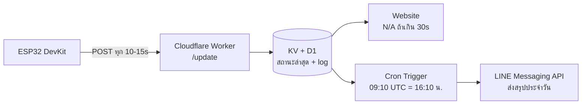

# 🔌 Appliance Status Notifier

ระบบแจ้งเตือนสถานะเครื่องใช้ไฟฟ้าแบบเรียลไทม์ ด้วย ESP32 + INA219 ส่งข้อมูลผ่าน Cloudflare Worker แสดงผลบนเว็บไซต์ และแจ้งเตือนสรุปประจำวันผ่าน LINE Messaging API

โครงงานการศึกษาค้นคว้าอิสระ (IS) — โรงเรียนนครสวรรค์


---

## สารบัญ

- [ภาพรวมระบบ](#ภาพรวมระบบ)
- [สถาปัตยกรรม](#สถาปัตยกรรม)
- [คุณสมบัติ](#คุณสมบัติ)
- [โครงสร้างโปรเจกต์](#โครงสร้างโปรเจกต์)
- [ฮาร์ดแวร์ที่ใช้](#ฮาร์ดแวร์ที่ใช้)
- [เริ่มต้นใช้งาน](#เริ่มต้นใช้งาน)
  - [1. Firmware (ESP32)](#1-firmware-esp32)
  - [2. Backend (Cloudflare Worker)](#2-backend-cloudflare-worker)
  - [3. Frontend (เว็บแสดงสถานะ)](#3-frontend-เว็บแสดงสถานะ)
- [API Endpoints](#api-endpoints)
- [ผู้จัดทำ](#ผู้จัดทำ)
- [License](#license)

---

## ภาพรวมระบบ

ระบบนี้ตรวจจับสถานะเปิด/ปิดของเครื่องใช้ไฟฟ้า DC (3-9V) โดยวัดกระแสไฟฟ้าผ่านเซนเซอร์ INA219 ประมวลผลด้วย ESP32 แล้วส่งข้อมูลไปเก็บและแสดงผลผ่าน Cloudflare Worker แบบเรียลไทม์ พร้อมสรุปแจ้งเตือนผ่าน LINE ทุกวันเวลา 16:10 น.

## สถาปัตยกรรม



## คุณสมบัติ

- ✅ ตรวจจับสถานะเปิด/ปิดเครื่องใช้ไฟฟ้าแบบเรียลไทม์
- ✅ วัดกระแส/แรงดัน/กำลังไฟฟ้าผ่าน INA219
- ✅ แสดงผลผ่านเว็บไซต์ พร้อมสถานะ `N/A` เมื่อ ESP32 หลุดการเชื่อมต่อ
- ✅ แจ้งเตือนสรุปประจำวันผ่าน LINE Messaging API เวลา 16:10 น.
- ✅ บันทึกประวัติการใช้งานย้อนหลังผ่าน Cloudflare D1

## โครงสร้างโปรเจกต์

```
appliance-notifier/
├── firmware/       # โค้ด ESP32 (PlatformIO)
├── backend/        # Cloudflare Worker
├── frontend/       # เว็บไซต์แสดงสถานะ
├── hardware/       # ไฟล์ KiCad (power-board, expansion-board)
└── docs/           # เอกสารประกอบ + เล่มรายงาน IS
```

## ฮาร์ดแวร์ที่ใช้

| ชิ้นส่วน | รายละเอียด |
|---|---|
| ESP32 DevKit | ไมโครคอนโทรลเลอร์หลัก |
| INA219 | เซนเซอร์วัดกระแส/แรงดัน/กำลังไฟฟ้า (I2C) |
| Expansion Board | บอร์ดเชื่อมต่อเซนเซอร์ + LED + สวิตช์เลือกแรงดัน (ออกแบบเอง) |

## เริ่มต้นใช้งาน

### 1. Firmware (ESP32)

```bash
cd firmware
pio run --target compiledb   # สร้าง compile_commands.json สำหรับ LSP
pio run --target upload      # อัปโหลดโค้ดขึ้นบอร์ด
pio device monitor           # ดู Serial Monitor
```

ตั้งค่า Wi-Fi และ URL ของ Worker ในไฟล์ `firmware/src/config.h`:

```cpp
#define WIFI_SSID "your-wifi-name"
#define WIFI_PASSWORD "your-wifi-password"
#define API_ENDPOINT "https://your-worker.workers.dev/update"
```

### 2. Backend (Cloudflare Worker)

```bash
cd backend
npm install
npx wrangler d1 create appliance-db     # สร้างฐานข้อมูล D1 ครั้งแรก
npx wrangler d1 execute appliance-db --file=./schema.sql
npx wrangler secret put LINE_ACCESS_TOKEN
npx wrangler deploy
```

### 3. Frontend (เว็บแสดงสถานะ)

```bash
cd frontend
# แก้ API_URL ใน script.js ให้ตรงกับ Worker ที่ deploy แล้ว
npx wrangler pages deploy .
```

## API Endpoints

| Method | Endpoint | คำอธิบาย |
|---|---|---|
| `POST` | `/update` | ESP32 ส่งค่าสถานะ/กระแส/กำลังไฟฟ้า |
| `GET` | `/status` | เว็บไซต์ดึงสถานะล่าสุดมาแสดงผล |
| `GET` | `/health` | ตรวจสอบว่า Worker ทำงานปกติ |

## ผู้จัดทำ

- ชื่อ-นามสกุลผู้จัดทำ — โรงเรียนนครสวรรค์
- ครูที่ปรึกษา — [ชื่อครูที่ปรึกษา]

โครงงานการศึกษาค้นคว้าอิสระ (Independent Study) ประจำภาคเรียนที่ 1 ปีการศึกษา 2569

## License

โครงการนี้เผยแพร่ภายใต้สัญญาอนุญาต [MIT License](LICENSE)
