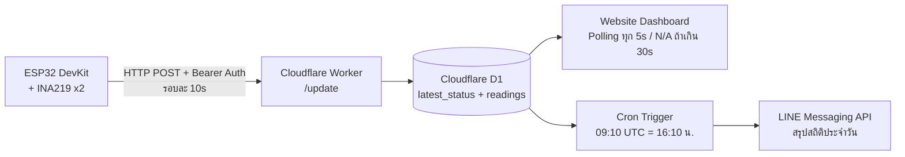
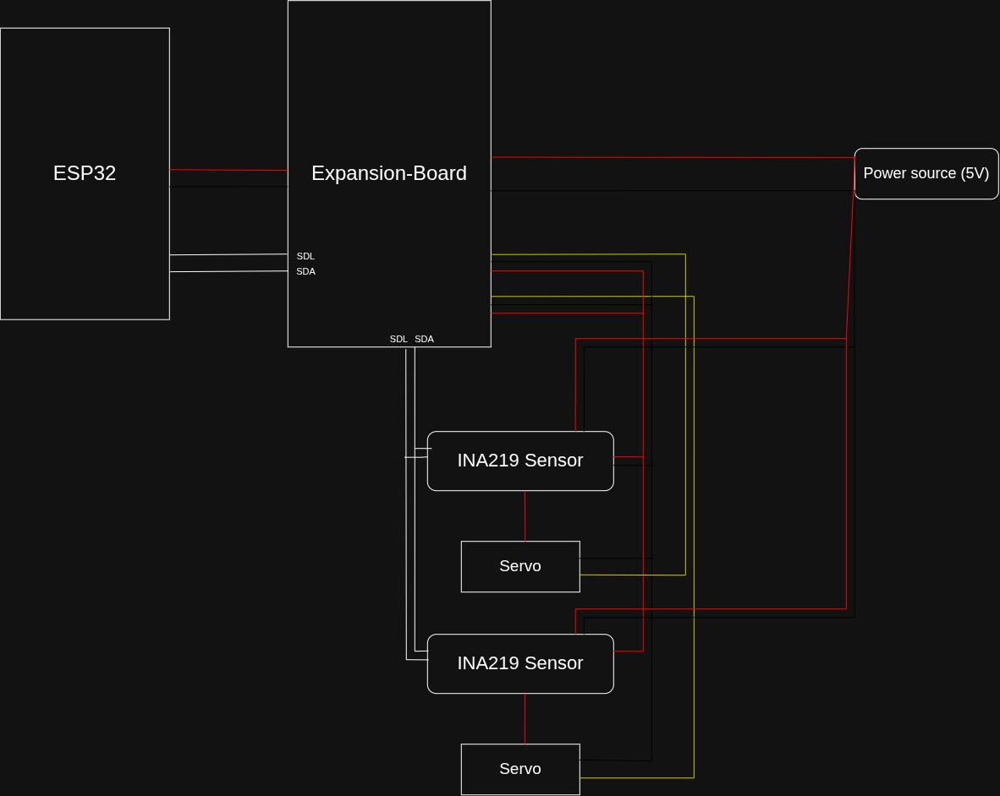

# Appliance Status Notifier (ระบบแจ้งเตือนสถานะอุปกรณ์ไฟฟ้า)

ระบบแจ้งเตือนสถานะอุปกรณ์ไฟฟ้าโดยตรวจจับกระแสไฟฟ้าแบบ near-realtime ด้วย ESP32 ร่วมกับ INA219 ส่งข้อมูลผ่าน Cloudflare Worker นำไปแสดงสถานะบนเว็บไซต์ และแจ้งเตือนสรุปประจำวันผ่าน LINE Messaging API ผ่าน LOA (Line Official Account) ทุกวันเวลา 16:10 น. โดยมีจุดประสงค์เป็นแนวทางการพัฒนาและต่อยอดเพิ่มขึ้นได้เรื่อยๆ ในด้านที่ท่านต้องการ<br>
----------
**รายละเอียดเพิ่มเติมสามารถดูได้ที่ folder ย่อยๆ หรือ documentation ข้างต้น**
**โครงงานการศึกษาค้นคว้าอิสระ (IS) <br>โรงเรียนนครสวรรค์ อำเภอเมืองนครสวรรค์ จังหวัดนครสวรรค์ ชั้นมัธยมศึกษาปีที่ 3**


[](https://github.com/dentenplay5555/Electrical-Status-Notification-System/actions/workflows/deploy-pages.yml)

---

## สารบัญ

- [ภาพรวมระบบ](#ภาพรวมระบบ)
- [สถาปัตยกรรม](#สถาปัตยกรรม)
- [คุณสมบัติ](#คุณสมบัติ)
- [โครงสร้างโปรเจกต์](#โครงสร้างโปรเจกต์)
- [ฮาร์ดแวร์ที่ใช้](#ฮาร์ดแวร์ที่ใช้)
- [เริ่มต้นใช้งาน](#เริ่มต้นใช้งาน)
  - [1. Firmware (ESP32)](#1-firmware-esp32)
  - [2. Backend (Cloudflare Worker)](#2-backend-cloudflare-worker)
  - [3. Frontend (เว็บแสดงสถานะ)](#3-frontend-เว็บแสดงสถานะ)
- [API Endpoints](#api-endpoints)
- [ผู้จัดทำ](#ผู้จัดทำ)
- [License](#license)

---

## ภาพรวมระบบและขอบเขต

ระบบนี้ตรวจจับสถานะเปิด/ปิดของ**อุปกรณ์ไฟฟ้ากระแสตรง (DC ช่วงแรงดัน 3–9 V)** เช่น พัดลมระบายความร้อน DC, เซอร์โวมอเตอร์ (Servo Motor) หรือชุดหลอดไฟส่องสว่าง โดยวัดกระแส แรงดัน และกำลังไฟฟ้าผ่านเซนเซอร์ INA219 ประมวลผลด้วย ESP32 DevKit แล้วส่งข้อมูลไปยัง Cloudflare Worker แบบ Near Real-time (รอบส่งข้อมูลทุก 10 วินาที) เพื่อนำไปแสดงผลบน Dashboard เว็บไซต์ พร้อมระบบสรุปการใช้พลังงานประจำวันผ่าน LINE Official Account (LOA) ทุกวันเวลา 16:10 น.

> **ขอบเขตการทำงาน (Scope & Limitations)**:
> - รองรับเฉพาะโหลดไฟฟ้ากระแสตรง (DC Load) แรงดัน 3.0 V – 9.0 V (ห้ามใช้กับไฟกระแสสลับ AC 220V เด็ดขาด)
> - รองรับกระแสไฟฟ้าสูงสุดไม่เกิน 3.2 A ตามสเปกชิป INA219 (Shunt Resistor 0.1 Ω)
> - ป้องกันสถานะกระพริบและการแจ้งเตือนผิดพลาดจากกระแส Standby ด้วยระบบ Hysteresis 2 ขอบ (ค่าเริ่มต้น: เปิด > 25 mA / ปิด < 15 mA ต้องปรับตามโหลดจริงที่วัดได้ ดูหัวข้อผลการทดลอง)

## สถาปัตยกรรมระบบ (Architecture)



### การจัดสรรฐานข้อมูล D1
- **ตาราง `latest_status`**: เก็บสถานะล่าสุดแบบ 1 แถวต่ออุปกรณ์ (UPSERT) เพื่อให้หน้าเว็บดึงข้อมูลได้เร็ว ทันที และไม่มีปัญหาเรื่องความล่าช้าในการซิงค์ข้อมูล
- **ตาราง `readings`**: เก็บประวัติการวัดค่าแบบ Time-Series Log ย้อนหลัง 7 วัน สำหรับคำนวณสถิติและพลังงานสูงสุดในสรุปประจำวัน (มีระบบ Prune ข้อมูลเก่าอัตโนมัติ)

### รอบการส่งข้อมูลและความหน่วง (Cycle & Latency Analysis)
ระบบนี้ทำงานแบบ Near Real-Time ความหน่วงแต่ละช่วงด้านล่างเป็น **ค่าตามการออกแบบ (ยังไม่ได้วัดจริง)** จะอัปเดตเป็นค่าที่วัดได้เมื่อทดสอบเสร็จ (ดูหัวข้อผลการทดลอง):
1. **อ่านค่าจากเซนเซอร์ (I2C)**: สุ่มทุก 1 วินาที
2. **ประมวลผลบน ESP32**: ตรวจเกณฑ์ Hysteresis และสร้าง JSON
3. **ส่ง HTTP POST ผ่าน Wi-Fi ไป Cloudflare Worker**: ขึ้นกับสัญญาณ Wi-Fi และเครือข่าย
4. **Worker ตรวจ Bearer Token และบันทึกลง D1**
5. **หน้าเว็บ Polling ทุก 5 วินาที**; ถ้าไม่มีข้อมูลใหม่เกิน 30 วินาที แสดง `N/A`
- **ความหน่วงรวม (End-to-End)**: เมื่อสถานะเปลี่ยน ESP32 ส่งทันทีในรอบสุ่มถัดไป (≤ 1 วินาที) เว็บจึงเห็นการเปลี่ยนภายในรอบ Polling 5 วินาที ส่วน Heartbeat 10 วินาทีใช้ยืนยันว่าอุปกรณ์ยังออนไลน์ ตัวเลขจริงจะรายงานหลังจับเวลา และไม่อ้างค่า latency ต่ำที่ยังไม่มีผลวัดยืนยัน

## ภาพผังวงจร (Circuit & Hardware)

ผังการเชื่อมต่อวงจรระหว่าง ESP32 DevKit, Expansion Board, INA219 เซนเซอร์คู่ และโหลด DC:



*(ไฟล์ KiCad ต้นฉบับ: [`hardware/Circut.kicad_pro`](hardware/Circut.kicad_pro) ดูรายละเอียดที่ [`hardware/README.md`](hardware/README.md))*


## ฮาร์ดแวร์ที่ใช้ (Requirement)

| ชิ้นส่วน | รายละเอียด |
|---|---|
| ESP32 DevKit | ไมโครคอนโทรลเลอร์หลัก |
| INA219 | เซนเซอร์วัดกระแส/แรงดัน/กำลังไฟฟ้า (I2C) |
| Expansion Board | บอร์ดเชื่อมต่อเซนเซอร์ + LED + สวิตช์เลือกแรงดัน |

## วิธีการเริ่มต้นใช้งาน
**มีความจำเป็นที่จะต้องติดตั้ง PlatformIO CLI, Node.js และ LOA จึงมีสิทธิใช้ Line Messaging API ได้(ตรวจโควตาข้อความต่อเดือนของแผนที่ใช้ได้ใน LINE Official Account Manager)**
**ข้อควรระวังสำหรับผู้ใช้ Linux การ upload code ผ่าน USB อาจเจอ error "access denied" ได้ ควรอนุญาตผ่าน serial port ที่ท่านประสงค์ใช้**

### 1. Firmware (ESP32)

```bash
cd firmware
# คัดลอก template config แล้วใส่ค่าจริง (ไฟล์นี้ถูก ignore แล้ว — ไม่ขึ้น git)
cp main-src/config.example.h main-src/config.h
# แก้ไข main-src/config.h ด้วย editor ของท่าน

pio run -e main --target compiledb   # สร้าง compile_commands.json สำหรับ LSP
pio run -e main --target upload      # อัปโหลดโค้ดขึ้นบอร์ด (main env)
pio device monitor                   # ดู Serial Monitor (Log)
# สำหรับทดสอบ i2c_scanner:
pio run -e testing --target upload
```

ค่าที่ต้องแก้ใน `firmware/main-src/config.h`:

```cpp
#define WIFI_SSID     "WIFI NAME"
#define WIFI_PASSWORD "WIFI PASS"
#define API_ENDPOINT  "https://<your-worker>.workers.dev/update"
#define DEVICE_TOKEN  "your_secret_device_token"  // ต้องตรงกับ secret บน Worker
```

### 2. Backend (Cloudflare Worker)

```bash
cd backend
npm install
npx wrangler d1 create appliance-db     # สร้าง Database D1 ครั้งแรก
npx wrangler d1 execute appliance-db --remote --file=./schema.sql   # ต้องมี --remote ไม่งั้นสร้างตารางแค่ในเครื่อง
npx wrangler secret put LINE_ACCESS_TOKEN
npx wrangler secret put DEVICE_TOKEN    # ใส่ token เดียวกันกับใน config.h (ไม่งั้นจะตอบ 401)
npx wrangler deploy
```

### 3. Frontend (เว็บแสดงสถานะ)

Frontend เป็น static HTML/CSS/JS ใน `frontend/` — deploy อัตโนมัติผ่าน GitHub Actions ไปยัง **GitHub Pages** ทุกครั้งที่ push ไปยัง branch `master`

```bash
# แก้ API_URL ใน frontend/script.js ให้ตรงกับ Worker ของท่าน
# จากนั้น push ไปที่ branch master — workflow จะ deploy ให้อัตโนมัติ
git add frontend/
git commit -m "update frontend"
git push origin master
```

## API Endpoints 

| Method | Endpoint | คำอธิบาย |
|---|---|---|
| `POST` | `/update` | ESP32 ส่งค่าสถานะ/กระแส/กำลังไฟฟ้า (ต้องมี Bearer Token) |
| `GET` | `/status` | เว็บไซต์ดึงสถานะล่าสุดมาแสดงผล (ส่ง status: "N/A" ถ้าเกิน 30s) |
| `GET` | `/health` | ตรวจสอบว่า Worker ทำงานปกติ |
| `GET` | `/summary` | ดึงสถิติสรุปพลังงานประจำวัน |
| `GET` | `/history` | ดึงประวัติการวัดค่าย้อนหลัง |

## ผลการทดลองและการทดสอบระบบ (Experimental Results)

> **สถานะ: อยู่ระหว่างการวัดผล** ตารางด้านล่างเป็นแบบฟอร์มเปล่า กรอกเฉพาะค่าที่วัดได้จริงเท่านั้น และเก็บ log / รูปถ่าย / วิดีโอ ไว้เป็นหลักฐานใน `docs/evidence/` (ถ้ายังไม่ได้ทดสอบข้อใด ให้เว้นว่างไว้)
> เครื่องมือวัด: `ina-logger` (log กระแส/แรงดัน/กำลัง และสถิติ OFF/ON) และ Serial Monitor ของ firmware หลัก

### 1. การสอบเทียบเกณฑ์ ON/OFF และความแม่นยำของ INA219

วิธี: ต่อโหลดจริงผ่าน INA219, เก็บ I (mA) ช่วงปิด/เปิดอย่างน้อยช่วงละ 30 วินาที แล้วเทียบกับมัลติมิเตอร์

| โหลด | แรงดันแหล่งจ่าย (V) | I ตอน OFF สูงสุด (mA) | I ตอน ON ต่ำสุด (mA) | I มัลติมิเตอร์ (mA) | I INA219 เฉลี่ย (mA) | % ความคลาดเคลื่อน |
|---|---|---|---|---|---|---|
| | | | | | | |

เกณฑ์ที่เลือกใช้: `CURRENT_OFF_THRESHOLD_MA` = ____ , `CURRENT_ON_THRESHOLD_MA` = ____ (เหตุผล: ____)

### 2. การตรวจจับสถานะเปิด/ปิด (Detection)

| รายการทดสอบ | เงื่อนไข | จำนวนครั้ง | ถูกต้อง | ความแม่นยำ (%) | หมายเหตุ |
|---|---|:---:|:---:|:---:|---|
| ON | | | | | |
| OFF | | | | | |
| Standby / กระแสต่ำ | | | | | |
| ช่วงกลาง (Hysteresis) | | | | | |

### 3. ความหน่วงและการส่งข้อมูล

| รายการ | วิธีวัด | จำนวนครั้ง | min | เฉลี่ย | max |
|---|---|:---:|---|---|---|
| สลับโหลด → หน้าเว็บเปลี่ยนสถานะ (วินาที) | อัดวิดีโอจอคู่โหลด นับเฟรม | | | | |
| HTTP RTT ของ POST /update (ms) | พิมพ์เวลาใน Serial | | | | |
| ถอดไฟ ESP32 → หน้าเว็บขึ้น N/A (วินาที) | จับเวลา | | | | |
| ส่งสำเร็จ / ทั้งหมด ใน ____ ชั่วโมง | นับ `[api] HTTP 200` | | | | |

### 4. สภาวะขัดข้องและความปลอดภัย

| สภาวะ | การจำลอง | จำนวนครั้ง | ผลที่ได้ตามคาด | หมายเหตุ |
|---|---|:---:|:---:|---|
| ถอดสาย I2C ขณะทำงาน | ปลด SDA/SCL | | | ต้องส่ง `ok:false` |
| POST ไม่มี token / token ผิด | `curl` | | | ต้องได้ 401 |

### 5. สรุปประจำวันผ่าน LINE

| วันที่ | ตารางเปิด/ปิดโหลดที่จดไว้ | % ON ที่ควรได้ | % ON ที่ LINE ส่งมา | ได้รับข้อความเวลา |
|---|---|---|---|---|
| | | | | |

## คณะจัดทำ
- คณะผู้จัดทำ <br>
   1.ด.ช.กฤตภาส ใจใหญ่ เลขที่ 1 ม.3/1<br>
   2.ด.ช.กิตติศักดิ์ วงษา เลขที่ 4 ม.3/1<br>
   3.ด.ช.ปกรณ์เกียรติ แหวนแก้ว เลขที่ 15 ม.3/1<br>
   4.ด.ช.วรัญชัย พุทธวงค์ เลขที่ 19 ม.3/1<br>
   5.ด.ช.วิชญะ เสาไธสง เลขที่ 20 ม.3/1<br>
   6.ด.ช.อชิระ ลิ้มสุวรรณ เลขที่ 21 ม.3/1<br>
   
- ครูที่ปรึกษา <br>
   1.ครูศิรประภา ปิ่นเทศ<br>
   2.ครูสุพรรณี อภิชัยเอนก<br>
   3.ครูธันยาณัฐ รังสิยานนท์<br>
   
**โครงงานการศึกษาค้นคว้าอิสระ (Independent Study (IS)) ประจำปีการศึกษา 2569 <br>โรงเรียนนครสวรรค์ อำเภอเมืองนครสวรรค์ จังหวัดนครสวรรค์**

## License

โครงงานนี้เผยแพร่ภายใต้สัญญาอนุญาต [MIT License](LICENSE.txt)
