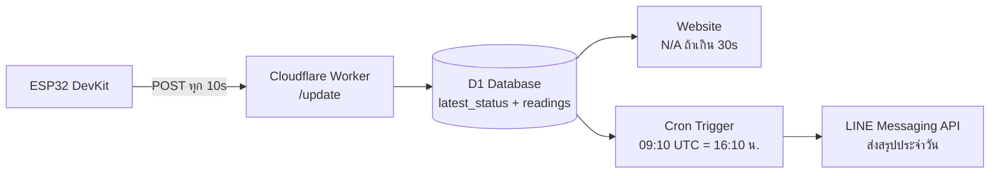

# Appliance Status Notifier (ระบบแจ้งเตือนสถานะอุปกรณ์ไฟฟ้า)

ระบบแจ้งเตือนสถานะอุปกรณ์ไฟฟ้าโดยตรวจจับกระแสไฟฟ้าแบบ near-realtime ด้วย ESP32 ร่วมกับ INA219 ส่งข้อมูลผ่าน Cloudflare Worker นำไปแสดงสถานะบนเว็บไซต์ และแจ้งเตือนสรุปประจำวันผ่าน LINE Messaging API ผ่าน LOA (Line Official Account) ทุกวันเวลา 16:10 น. โดยมีจุดประสงค์เป็นแนวทางการพัฒนาและต่อยอดเพิ่มขึ้นได้เรื่อยๆ ในด้านที่ท่านต้องการ<br>
----------
**รายละเอียดเพิ่มเติมสามารถดูได้ที่ folder ย่อยๆ หรือ documentation ข้างต้น**
**โครงงานการศึกษาค้นคว้าอิสระ (IS) <br>โรงเรียนนครสวรรค์ อำเภอเมืองนครสวรรค์ จังหวัดนครสวรรค์ ชั้นมัธยมศึกษาปีที่ 3**


[](https://github.com/dentenplay5555/Electrical-Status-Notification-System/actions/workflows/deploy-pages.yml)

---

## สารบัญ

- [ภาพรวมระบบ](#ภาพรวมระบบ)
- [สถาปัตยกรรม](#สถาปัตยกรรม)
- [คุณสมบัติ](#คุณสมบัติ)
- [โครงสร้างโปรเจกต์](#โครงสร้างโปรเจกต์)
- [ฮาร์ดแวร์ที่ใช้](#ฮาร์ดแวร์ที่ใช้)
- [เริ่มต้นใช้งาน](#เริ่มต้นใช้งาน)
  - [1. Firmware (ESP32)](#1-firmware-esp32)
  - [2. Backend (Cloudflare Worker)](#2-backend-cloudflare-worker)
  - [3. Frontend (เว็บแสดงสถานะ)](#3-frontend-เว็บแสดงสถานะ)
- [API Endpoints](#api-endpoints)
- [ผู้จัดทำ](#ผู้จัดทำ)
- [License](#license)

---

## ภาพรวมระบบ

ระบบนี้ตรวจจับสถานะเปิด/ปิดของอุปกรณ์ไฟฟ้า DC (3-9V) โดยวัดกระแสไฟฟ้าผ่านเซนเซอร์ INA219 ประมวลผลด้วย ESP32 แล้วส่งข้อมูลไปเก็บและแสดงผล ผ่าน Cloudflare Worker ใกล้เคียงเรียลไทม์ พร้อมสรุปแจ้งเตือนผ่าน Line Official Account (LOA) และ website ทุกวันเวลา 16:10 น.

## สถาปัตยกรรม หรือ หลักการทำงาน



## คุณสมบัติ

- ตรวจจับสถานะเปิด/ปิดอุปกรณ์ไฟฟ้า ได้ทุกที่ ทุกเวลา
- วัดกระแส/แรงดัน/กำลังไฟฟ้าผ่าน INA219
- แสดงผลผ่านเว็บไซต์ พร้อมสถานะ `N/A` เมื่อ ESP32 หลุดการเชื่อมต่อ
- ป้องกันการเกิดภาวะข้อมูลแกว่ง (hysteresis) โดยมีเกณฑ์เปิด 25 mA / ปิด 15 mA
- แจ้งเตือนสรุปประจำวันผ่าน LINE Messaging API เวลา 16:10 น.
- บันทึกประวัติการใช้งานย้อนหลังผ่าน Cloudflare D1

## โครงสร้างโปรเจกต์

```
appliance-notifier/
├── firmware/       # Source code ESP32 (PlatformIO)
├── backend/        # Cloudflare Worker (Server กลาง)
├── frontend/       # เว็บไซต์แสดงสถานะ
├── hardware/       # ไฟล์ KiCad (expansion-board)
└── docs/           # เอกสารประกอบ + เล่มรายงาน IS
```

## ฮาร์ดแวร์ที่ใช้ (Requirement)

| ชิ้นส่วน | รายละเอียด |
|---|---|
| ESP32 DevKit | ไมโครคอนโทรลเลอร์หลัก |
| INA219 | เซนเซอร์วัดกระแส/แรงดัน/กำลังไฟฟ้า (I2C) |
| Expansion Board | บอร์ดเชื่อมต่อเซนเซอร์ + LED + สวิตช์เลือกแรงดัน |

## วิธีการเริ่มต้นใช้งาน
**มีความจำเป็นที่จะต้องติดตั้ง PlatformIO CLI, Node.js และ LOA จึงมีสิทธิใช้ Line Messaging API ได้โดยมี Limit push คือ 200 ครั้ง/เดือน (Free tier)**
**ข้อควรระวังสำหรับผู้ใช้ Linux การ upload code ผ่าน USB อาจเจอ error "access denied" ได้ ควรอนุญาตผ่าน serial port ที่ท่านประสงค์ใช้**

### 1. Firmware (ESP32)

```bash
cd firmware
# คัดลอก template config แล้วใส่ค่าจริง (ไฟล์นี้ถูก ignore แล้ว — ไม่ขึ้น git)
cp main-src/config.example.h main-src/config.h
# แก้ไข main-src/config.h ด้วย editor ของท่าน

pio run -e main --target compiledb   # สร้าง compile_commands.json สำหรับ LSP
pio run -e main --target upload      # อัปโหลดโค้ดขึ้นบอร์ด (main env)
pio device monitor                   # ดู Serial Monitor (Log)
# สำหรับทดสอบ i2c_scanner:
pio run -e testing --target upload
```

ค่าที่ต้องแก้ใน `firmware/main-src/config.h`:

```cpp
#define WIFI_SSID     "WIFI NAME"
#define WIFI_PASSWORD "WIFI PASS"
#define API_ENDPOINT  "https://<your-worker>.workers.dev/update"
#define DEVICE_TOKEN  "your_secret_device_token"  // ต้องตรงกับ secret บน Worker
```

### 2. Backend (Cloudflare Worker)

```bash
cd backend
npm install
npx wrangler d1 create appliance-db     # สร้าง Database D1 ครั้งแรก
npx wrangler d1 execute appliance-db --file=./schema.sql
npx wrangler secret put LINE_ACCESS_TOKEN
npx wrangler secret put DEVICE_TOKEN    # ใส่ token เดียวกันกับใน config.h (ไม่งั้นจะตอบ 401)
npx wrangler deploy
```

### 3. Frontend (เว็บแสดงสถานะ)

Frontend เป็น static HTML/CSS/JS ใน `frontend/` — deploy อัตโนมัติผ่าน GitHub Actions ไปยัง **GitHub Pages** ทุกครั้งที่ push ไปยัง branch `master`

```bash
# แก้ API_URL ใน frontend/script.js ให้ตรงกับ Worker ของท่าน
# จากนั้น push ไปที่ branch master — workflow จะ deploy ให้อัตโนมัติ
git add frontend/
git commit -m "update frontend"
git push origin master
```

## API Endpoints 

| Method | Endpoint | คำอธิบาย |
|---|---|---|
| `POST` | `/update` | ESP32 ส่งค่าสถานะ/กระแส/กำลังไฟฟ้า |
| `GET` | `/status` | เว็บไซต์ดึงสถานะล่าสุดมาแสดงผล |
| `GET` | `/health` | ตรวจสอบว่า Worker ทำงานปกติ |

## คณะจัดทำ
- คณะผู้จัดทำ <br>
   1.ด.ช.กฤตภาส ใจใหญ่ เลขที่ 1 ม.3/1<br>
   2.ด.ช.กิตติศักดิ์ วงษา เลขที่ 4 ม.3/1<br>
   3.ด.ช.ปกรณ์เกียรติ แหวนแก้ว เลขที่ 15 ม.3/1<br>
   4.ด.ช.วรัญชัย พุทธวงค์ เลขที่ 19 ม.3/1<br>
   5.ด.ช.วิชญะ เสาไธสง เลขที่ 20 ม.3/1<br>
   6.ด.ช.อชิระ ลิ้มสุวรรณ เลขที่ 21 ม.3/1<br>
   
- ครูที่ปรึกษา <br>
   1.ครูศิรประภา ปิ่นเทศ<br>
   2.ครูสุพรรณี อภิชัยเอนก<br>
   3.ครูธันยาณัฐ รังสิยานนท์<br>
   
**โครงงานการศึกษาค้นคว้าอิสระ (Independent Study (IS)) ประจำปีการศึกษา 2569 <br>โรงเรียนนครสวรรค์ อำเภอเมืองนครสวรรค์ จังหวัดนครสวรรค์**

## License

โครงงานนี้เผยแพร่ภายใต้สัญญาอนุญาต [MIT License](LICENSE.txt)
