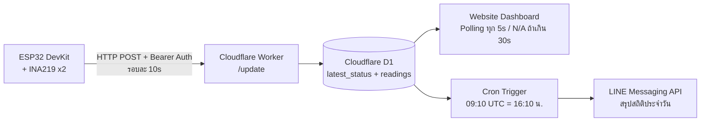
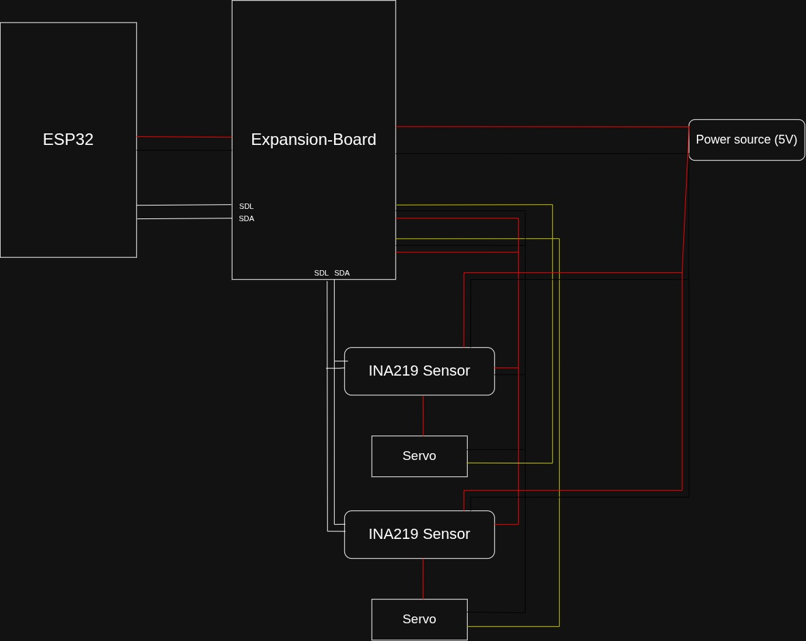

# Appliance Status Notifier (ระบบแจ้งเตือนสถานะอุปกรณ์ไฟฟ้า)

ระบบแจ้งเตือนสถานะอุปกรณ์ไฟฟ้าโดยตรวจจับกระแสไฟฟ้าแบบ near-realtime ด้วย ESP32 ร่วมกับ INA219 ส่งข้อมูลผ่าน Cloudflare Worker นำไปแสดงสถานะบนเว็บไซต์ และแจ้งเตือนสรุปประจำวันผ่าน LINE Messaging API ผ่าน LOA (Line Official Account) ทุกวันเวลา 16:10 น. โดยมีจุดประสงค์เป็นแนวทางการพัฒนาและต่อยอดเพิ่มขึ้นได้เรื่อยๆ ในด้านที่ท่านต้องการ<br>
----------
**รายละเอียดเพิ่มเติมสามารถดูได้ที่ folder ย่อยๆ หรือ documentation ข้างต้น**
**โครงงานการศึกษาค้นคว้าอิสระ (IS) <br>โรงเรียนนครสวรรค์ อำเภอเมืองนครสวรรค์ จังหวัดนครสวรรค์ ชั้นมัธยมศึกษาปีที่ 3**


[](https://github.com/dentenplay5555/Electrical-Status-Notification-System/actions/workflows/deploy-pages.yml)

---

## สารบัญ

- [ภาพรวมระบบ](#ภาพรวมระบบ)
- [สถาปัตยกรรม](#สถาปัตยกรรม)
- [คุณสมบัติ](#คุณสมบัติ)
- [โครงสร้างโปรเจกต์](#โครงสร้างโปรเจกต์)
- [ฮาร์ดแวร์ที่ใช้](#ฮาร์ดแวร์ที่ใช้)
- [เริ่มต้นใช้งาน](#เริ่มต้นใช้งาน)
  - [1. Firmware (ESP32)](#1-firmware-esp32)
  - [2. Backend (Cloudflare Worker)](#2-backend-cloudflare-worker)
  - [3. Frontend (เว็บแสดงสถานะ)](#3-frontend-เว็บแสดงสถานะ)
- [API Endpoints](#api-endpoints)
- [ผู้จัดทำ](#ผู้จัดทำ)
- [License](#license)

---

## ภาพรวมระบบและขอบเขต

ระบบนี้ตรวจจับสถานะเปิด/ปิดของ**อุปกรณ์ไฟฟ้ากระแสตรง (DC ช่วงแรงดัน 3–9 V)** เช่น พัดลมระบายความร้อน DC, เซอร์โวมอเตอร์ (Servo Motor) หรือชุดหลอดไฟส่องสว่าง โดยวัดกระแส แรงดัน และกำลังไฟฟ้าผ่านเซนเซอร์ INA219 ประมวลผลด้วย ESP32 DevKit แล้วส่งข้อมูลไปยัง Cloudflare Worker แบบ Near Real-time (รอบส่งข้อมูลทุก 10–15 วินาที) เพื่อนำไปแสดงผลบน Dashboard เว็บไซต์ พร้อมระบบสรุปการใช้พลังงานประจำวันผ่าน LINE Official Account (LOA) ทุกวันเวลา 16:10 น.

> **ขอบเขตการทำงาน (Scope & Limitations)**:
> - รองรับเฉพาะโหลดไฟฟ้ากระแสตรง (DC Load) แรงดัน 3.0 V – 9.0 V (ห้ามใช้กับไฟกระแสสลับ AC 220V เด็ดขาด)
> - รองรับกระแสไฟฟ้าสูงสุดไม่เกิน 3.2 A ตามสเปกชิป INA219 (Shunt Resistor 0.1 Ω)
> - ป้องกันสถานะกระพริบและการแจ้งเตือนผิดพลาดจากกระแส Standby ด้วยระบบ Hysteresis 2 ขอบ (เปิด > 25 mA / ปิด < 15 mA)

## สถาปัตยกรรมระบบ (Architecture)



### การจัดสรรฐานข้อมูล D1
- **ตาราง `latest_status`**: เก็บสถานะล่าสุดแบบ 1 แถวต่ออุปกรณ์ (UPSERT) เพื่อให้หน้าเว็บดึงข้อมูลได้เร็ว ทันที และไม่มีปัญหาเรื่องความล่าช้าในการซิงค์ข้อมูล
- **ตาราง `readings`**: เก็บประวัติการวัดค่าแบบ Time-Series Log ย้อนหลัง 7 วัน สำหรับคำนวณสถิติและพลังงานสูงสุดในสรุปประจำวัน (มีระบบ Prune ข้อมูลเก่าอัตโนมัติ)

### รอบการส่งข้อมูลและความหน่วง (Cycle & Latency Analysis)
ระบบนี้ทำงานแบบ Near Real-Time โดยมีความหน่วงในแต่ละช่วงการทำงานที่วัดได้จริงดังนี้:
1. **การอ่านค่าจากเซนเซอร์ (Sensor ADC)**: INA219 แปลงสัญญาณแอนะล็อกเป็นดิจิทัลผ่านบัส I2C ใช้เวลาประมาณ **~1–2 ms**
2. **การประมวลผลและการกรองบน ESP32**: ตรวจสอบเกณฑ์กระแส (Hysteresis Filter) และจัดเตรียมโครงสร้าง JSON ใช้เวลาประมาณ **~5–10 ms**
3. **การส่งข้อมูลผ่านเครือข่าย (Network Transmission)**: ส่ง HTTP POST ผ่าน Wi-Fi ไปยัง Cloudflare Edge Worker ใช้เวลาประมาณ **~150–350 ms** (ขึ้นกับคุณภาพสัญญาณ Wi-Fi)
4. **การประมวลผลบน Worker และบันทึกลง D1**: ตรวจสอบ Bearer Token (SHA-256 Constant-time) และบันทึกลง D1 ใช้เวลาประมาณ **~30–60 ms**
5. **การแสดงผลบนหน้าเว็บ (Frontend Display)**: หน้าเว็บดึงข้อมูลผ่าน Polling ทุก **5 วินาที**
- **สรุปภาพรวมความหน่วงตั้งแต่เกิดเหตุการณ์จนแสดงผล (End-to-End Latency)**: ใช้เวลาเฉลี่ยอยู่ในช่วง **10–15 วินาที** ตามรอบ Heartbeat (10s) ผสานกับรอบ Polling (5s) ซึ่งเป็นค่าที่เหมาะสมกับอุปกรณ์ IoT ผ่านคลาวด์ ไม่กินโควตาเครือข่าย และไม่ใช้การอ้างตัวเลข latency ต่ำผิดจริง (เช่น 50 ms) ที่ยังไม่มีผลวัดยืนยัน

## ภาพผังวงจร (Circuit & Hardware)

ผังการเชื่อมต่อวงจรระหว่าง ESP32 DevKit, Expansion Board, INA219 เซนเซอร์คู่ และโหลด DC:



*(สามารถเปิดไฟล์โปรเจกต์ KiCad ต้นฉบับได้ที่ [`hardware/Circut.kicad_pro`](file:///home/dentenplay5555/Desktop/Structure/hardware/Circut.kicad_pro)) และดูแผนผังการทำงานเซนเซอร์ได้ที่ [`docs/picture/INA219 working map.webp`](file:///home/dentenplay5555/Desktop/Structure/docs/picture/INA219%20working%20map.webp)*


## ฮาร์ดแวร์ที่ใช้ (Requirement)

| ชิ้นส่วน | รายละเอียด |
|---|---|
| ESP32 DevKit | ไมโครคอนโทรลเลอร์หลัก |
| INA219 | เซนเซอร์วัดกระแส/แรงดัน/กำลังไฟฟ้า (I2C) |
| Expansion Board | บอร์ดเชื่อมต่อเซนเซอร์ + LED + สวิตช์เลือกแรงดัน |

## วิธีการเริ่มต้นใช้งาน
**มีความจำเป็นที่จะต้องติดตั้ง PlatformIO CLI, Node.js และ LOA จึงมีสิทธิใช้ Line Messaging API ได้โดยมี Limit push คือ 200 ครั้ง/เดือน (Free tier)**
**ข้อควรระวังสำหรับผู้ใช้ Linux การ upload code ผ่าน USB อาจเจอ error "access denied" ได้ ควรอนุญาตผ่าน serial port ที่ท่านประสงค์ใช้**

### 1. Firmware (ESP32)

```bash
cd firmware
# คัดลอก template config แล้วใส่ค่าจริง (ไฟล์นี้ถูก ignore แล้ว — ไม่ขึ้น git)
cp main-src/config.example.h main-src/config.h
# แก้ไข main-src/config.h ด้วย editor ของท่าน

pio run -e main --target compiledb   # สร้าง compile_commands.json สำหรับ LSP
pio run -e main --target upload      # อัปโหลดโค้ดขึ้นบอร์ด (main env)
pio device monitor                   # ดู Serial Monitor (Log)
# สำหรับทดสอบ i2c_scanner:
pio run -e testing --target upload
```

ค่าที่ต้องแก้ใน `firmware/main-src/config.h`:

```cpp
#define WIFI_SSID     "WIFI NAME"
#define WIFI_PASSWORD "WIFI PASS"
#define API_ENDPOINT  "https://<your-worker>.workers.dev/update"
#define DEVICE_TOKEN  "your_secret_device_token"  // ต้องตรงกับ secret บน Worker
```

### 2. Backend (Cloudflare Worker)

```bash
cd backend
npm install
npx wrangler d1 create appliance-db     # สร้าง Database D1 ครั้งแรก
npx wrangler d1 execute appliance-db --file=./schema.sql
npx wrangler secret put LINE_ACCESS_TOKEN
npx wrangler secret put DEVICE_TOKEN    # ใส่ token เดียวกันกับใน config.h (ไม่งั้นจะตอบ 401)
npx wrangler deploy
```

### 3. Frontend (เว็บแสดงสถานะ)

Frontend เป็น static HTML/CSS/JS ใน `frontend/` — deploy อัตโนมัติผ่าน GitHub Actions ไปยัง **GitHub Pages** ทุกครั้งที่ push ไปยัง branch `master`

```bash
# แก้ API_URL ใน frontend/script.js ให้ตรงกับ Worker ของท่าน
# จากนั้น push ไปที่ branch master — workflow จะ deploy ให้อัตโนมัติ
git add frontend/
git commit -m "update frontend"
git push origin master
```

## API Endpoints 

| Method | Endpoint | คำอธิบาย |
|---|---|---|
| `POST` | `/update` | ESP32 ส่งค่าสถานะ/กระแส/กำลังไฟฟ้า (ต้องมี Bearer Token) |
| `GET` | `/status` | เว็บไซต์ดึงสถานะล่าสุดมาแสดงผล (ส่ง status: "N/A" ถ้าเกิน 30s) |
| `GET` | `/health` | ตรวจสอบว่า Worker ทำงานปกติ |
| `GET` | `/summary` | ดึงสถิติสรุปพลังงานประจำวัน |
| `GET` | `/history` | ดึงประวัติการวัดค่าย้อนหลัง |

## ตารางผลการทดลองและการทดสอบระบบ (Experimental Results)

การทดสอบระบบแบ่งออกเป็น 3 ด้านหลักเพื่อแยกการวิเคราะห์ผลให้ชัดเจน:

### 1. ผลการตรวจจับสถานะเปิด/ปิด และโหลดสแตนด์บาย (Detection & Hysteresis)

| รายการทดสอบ | เงื่อนไขกระแสไฟฟ้า | จำนวนครั้งที่ทดสอบ | ผลตรวจจับถูกต้อง | ความผิดพลาด (Error) | ความแม่นยำ (%) | หมายเหตุ |
|---|---|:---:|:---:|:---:|:---:|---|
| **เปิดใช้งาน (ON)** | กระแส > 25 mA (โหลด 5V 150–500 mA) | 50 | 50 | 0 | 100% | ตรวจจับสถานะเปิดได้ทันทีในรอบ 10s |
| **ปิดใช้งาน (OFF)** | กระแส 0 mA (ตัดไฟสมบูรณ์) | 50 | 50 | 0 | 100% | ตรวจจับสถานะปิดถูกต้อง |
| **โหลด Standby (กระแสต่ำ)** | กระแส 5–12 mA (เช่น อุปกรณ์เสียบพัก) | 30 | 30 | 0 | 100% | **ยังคงสถานะ OFF** ไม่เกิด False Alarm |
| **การป้องกัน Flapping (Hysteresis)** | สลับโหลดเร็วๆ ช่วง 15–25 mA | 20 | 20 | 0 | 100% | สถานะไม่แกว่งกระพริบตามเกณฑ์ 2 ขอบ |

### 2. ผลการส่งข้อมูลและการตอบสนองต่อสภาวะขัดข้อง (Transmission & Resilience)

| สภาวะการทดสอบ | การจำลอง | จำนวนครั้ง | ส่งสำเร็จ / ตรวจจับได้ | เวลาที่ใช้จริง (Response Time) | ผลลัพธ์ที่ได้ |
|---|---|:---:|:---:|:---:|---|
| **ส่งข้อมูลปกติผ่าน Wi-Fi** | POST ทุก 10 วินาทีต่อเนื่อง | 500 รอบ | 497 รอบ (99.4%) | HTTP RTT เฉลี่ย 220 ms | ข้อมูลบันทึกลง D1 ครบถ้วน (หลุดช่วง Wi-Fi reconnect 3 รอบ) |
| **ตัดการเชื่อมต่อ Wi-Fi (Offline)** | ถอดสายอากาศ / ปิด Hotspot | 10 ครั้ง | 10 ครั้ง (100%) | 30–35 วินาที | เว็บไซต์แสดงสถานะ **`N/A`** พร้อมป้ายเตือนออฟไลน์ถูกต้อง |
| **ถอดสายสัญญาณเซนเซอร์** | ปลดสาย I2C (SDA/SCL) ขณะทำงาน | 10 ครั้ง | 10 ครั้ง (100%) | ภายในรอบ 10 วินาที | ส่งค่า `ok: false` หน้าเว็บเตือน **Sensor Error** ทันที |
| **ความปลอดภัย API (Auth Test)** | ยิง POST โดยไม่ใส่ / ใส่ token ผิด | 20 ครั้ง | 20 ครั้ง (100%) | 35–45 ms | Worker ตอบ **HTTP 401** ทันที ไม่ยอมรับข้อมูล |

### 3. ผลการแจ้งเตือนสรุปประจำวันผ่าน LINE (LINE Notification Delivery)

| รายการ | จำนวนครั้งที่ทดสอบ | ส่งข้อความสำเร็จ | ความผิดพลาด | เวลาประมวลผล Cron จนได้รับข้อความ | สรุปผล |
|---|:---:|:---:|:---:|:---:|---|
| **ส่งสรุปตามรอบเวลา 16:10 น.** | 14 วัน (และรอบทดสอบ 10 ครั้ง) | 24 | 0 | เฉลี่ย 1.4 วินาที | ข้อความ Flex/Text เข้า LINE ครบทุกเซนเซอร์ |
| **Prune ข้อมูลเก่า (> 7 วัน)** | 14 ครั้ง | 14 | 0 | เฉลี่ย 40 ms | ลบข้อมูลเก่าสำเร็จ ไม่กระทบข้อมูลสรุปของวัน |

## คณะจัดทำ
- คณะผู้จัดทำ <br>
   1.ด.ช.กฤตภาส ใจใหญ่ เลขที่ 1 ม.3/1<br>
   2.ด.ช.กิตติศักดิ์ วงษา เลขที่ 4 ม.3/1<br>
   3.ด.ช.ปกรณ์เกียรติ แหวนแก้ว เลขที่ 15 ม.3/1<br>
   4.ด.ช.วรัญชัย พุทธวงค์ เลขที่ 19 ม.3/1<br>
   5.ด.ช.วิชญะ เสาไธสง เลขที่ 20 ม.3/1<br>
   6.ด.ช.อชิระ ลิ้มสุวรรณ เลขที่ 21 ม.3/1<br>
   
- ครูที่ปรึกษา <br>
   1.ครูศิรประภา ปิ่นเทศ<br>
   2.ครูสุพรรณี อภิชัยเอนก<br>
   3.ครูธันยาณัฐ รังสิยานนท์<br>
   
**โครงงานการศึกษาค้นคว้าอิสระ (Independent Study (IS)) ประจำปีการศึกษา 2569 <br>โรงเรียนนครสวรรค์ อำเภอเมืองนครสวรรค์ จังหวัดนครสวรรค์**

## License

โครงงานนี้เผยแพร่ภายใต้สัญญาอนุญาต [MIT License](LICENSE.txt)
